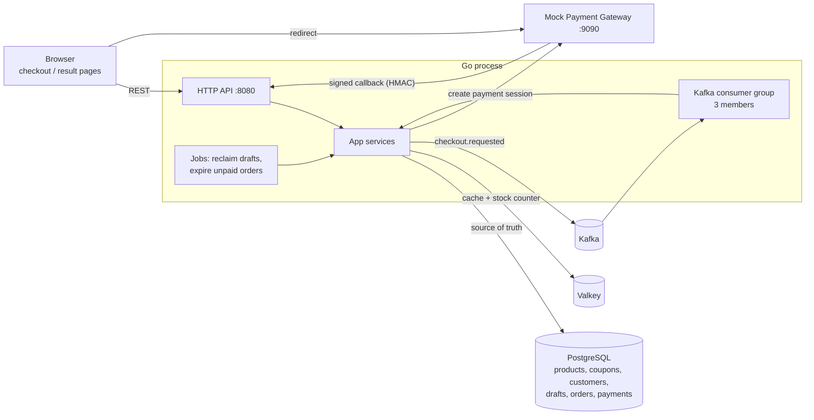
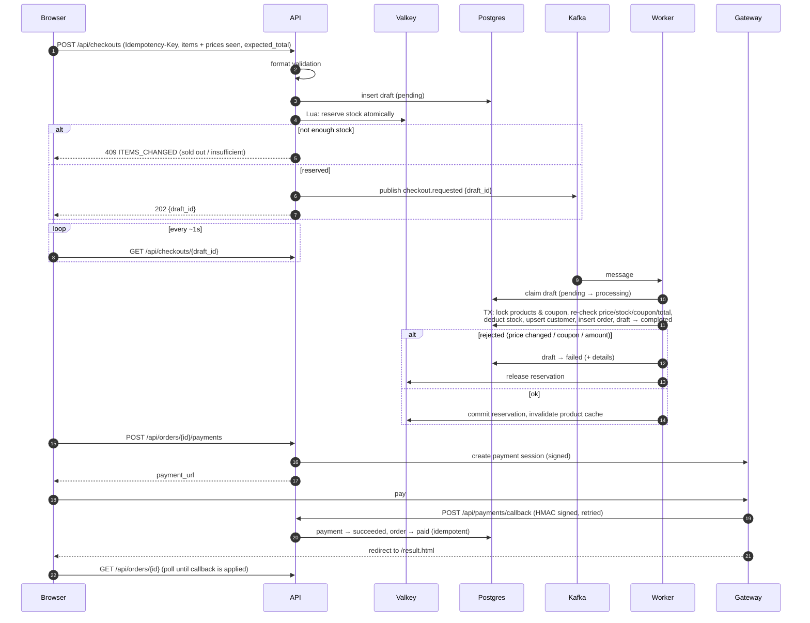

# Checkout Demo

A runnable local checkout system that covers the critical transaction flow end to end:
product → checkout page → async order creation → third-party payment (mocked) → callback → result page.

**Stack:** Go 1.24 (stdlib `net/http`), PostgreSQL 16, Valkey 8, Kafka 3.8 (KRaft), vanilla HTML/JS. The frontend is embedded into the Go binary.

## Quick start

```bash
make up          # docker compose up --build -d  (first start ~30s, Kafka is the slowest)
open http://localhost:8080
make logs        # follow app logs
make reset       # wipe data; DB is re-seeded on next start
```

To run the Go app on the host instead: `make infra`, then `make run`.

| URL | What |
|---|---|
| http://localhost:8080 | Product list with cart |
| http://localhost:8080/admin.html | Demo admin: change price / stock (opens in its own tab from the top bar) |
| http://localhost:8080/checkout.html?items=1:2,2:1 | Checkout page; `product_id:quantity` pairs come from the query string (`?product_id=1&qty=1` also works) |
| http://localhost:9090 | Mock payment gateway; a separate server that simulates a third party |

## Demo scenarios

| # | Scenario | How |
|---|---|---|
| 1 | Happy path | Add several products to the cart (or open a checkout URL) → credit card `4242 4242 4242 4242` → result page shows **付款完成** |
| 2 | Card declined, then retry | Use card `4000 0000 0000 0002` → result page shows **付款未完成** → 重新付款 |
| 3 | Price changed while the shopper is on the page | Open checkout, change the price in the admin tab (`/admin.html`), submit → modal lists the change, page refreshes, shopper re-confirms |
| 4 | Not enough stock / sold out | Set stock to 1 in admin and choose qty 2, or open product 3 (sold out). With several products, the reservation is all-or-nothing: nothing is held if one item is short |
| 5 | Last unit race | Set stock = 1, submit from two tabs → exactly one wins, the other gets an immediate **已售完** |
| 6 | Coupons | `RETURN500` (min 3,000), `SAVE10` (10% off), `ONCE100` (single use; second order is rejected) |
| 7 | ATM / AFTEE | Pick the method; the gateway shows a virtual account and a "simulate transfer" button |
| 8 | Double submit | Double-click submit or retry after a network error → same `Idempotency-Key`, so only one order |
| 9 | Unpaid order expiry | Set `PAYMENT_TTL_SECONDS=60`, leave an order unpaid → it expires and stock is returned |

## Architecture



Code layout (layered: interfaces → app → domain, with infra behind it):

```
cmd/main.go                      wiring, graceful shutdown
config/                          env config
db/migrations/                   schema + seed (run by postgres initdb)
internal/domain/{def,model}      error codes, statuses, pricing & validation (pure, unit tested)
internal/app/                    ProductService, CheckoutService, OrderService, PaymentService
internal/app/adapter/            service input / output types
internal/infra/database/repo     PostgreSQL (pgx)
internal/infra/cache             product cache + stock reservation (Lua)
internal/infra/producer          Kafka producer
internal/infra/paymentgateway    gateway client + signature verification
internal/interfaces/web          HTTP handlers
internal/interfaces/consumer     Kafka consumer
internal/interfaces/job          background jobs
internal/mockgateway             the fake third-party payment provider
web/static                       frontend
```

## Transaction flow



### Status machines

- **Draft:** `pending → processing → completed | failed`. Transient errors put it back to `pending`; a job re-publishes it.
- **Order:** `pending_payment → paid | expired`. `refund_required` means the payment arrived after the order had expired.
- **Payment:** one order can have several attempts, each `pending → succeeded | failed | expired`.

## Key design decisions

### 1. The price or stock changed after the shopper loaded the page
The client sends the unit price it displayed and the `expected_total` the shopper confirmed. The server **never silently applies a new price**. It rejects with `ITEMS_CHANGED` (per-item reason: `PRICE_CHANGED`, `INSUFFICIENT_STOCK`, `SOLD_OUT`, `NOT_FOUND`) or `AMOUNT_MISMATCH`. The page re-fetches products, updates itself, and asks the shopper to confirm again.

### 2. Async order creation with Kafka
`POST /api/checkouts` only persists a draft and returns `202`. The heavy, contended work (row locks, stock deduction) runs in a consumer group, so traffic spikes are smoothed instead of piling up DB connections in request handlers.

- Topic `checkout.requested` has 3 partitions, keyed by `draft_id`.
- Offsets are committed **after** handling (at-least-once delivery).
- Duplicate messages are harmless:
  - the worker claims a draft with `UPDATE … WHERE status='pending'`;
  - `orders.draft_id` is `UNIQUE`.
- A failing draft never blocks a partition. It is put back to `pending`, the offset is committed, and the reclaim job re-publishes it.
- The **draft row in Postgres is the source of truth.** If a publish fails or a worker dies, the reclaim job re-publishes drafts that are `pending` for more than 10s or `processing` for more than 60s.

### 3. Fairness: who gets the last unit
Kafka only orders messages within a partition, and with several consumers the completion order is not the submit order anyway. A single partition would kill parallelism. Instead, stock is **reserved synchronously in Valkey** with an atomic Lua script when the shopper submits:

- `stock:{id}` = available units = DB stock − units held by in-flight drafts
- `reservation:{draft_id}` = which units this draft holds

Valkey runs commands one at a time, so the first request to reach it wins, and losers get an instant "sold out" without waiting for the async pipeline. Reservations are:

- **released** when a draft fails (idempotent);
- **committed** when the order is created;
- **returned** to the counter when an unpaid order expires.

The DB conditional update `stock >= qty` plus `CHECK (stock >= 0)` stays as the final guard against overselling. If Valkey and the DB ever disagree, the worst case is a rejected order, never an oversold one.

The draft is written before the reservation is taken. If the process crashes between the two, the draft is still processed safely by the DB guard; with the opposite order, reserved units could leak.

### 4. DB + cache writes for product updates
`PUT /api/admin/products/{id}`:

1. Update the row inside a DB transaction.
2. Write Valkey **before commit**. If the cache write fails, roll back.
3. If the commit fails after the cache was written, delete the cache key.

So "DB and cache both succeed, or nothing changes". Reads use cache-aside.

### 5. Payment
- The gateway client signs requests. Callbacks are verified with HMAC-SHA256 and the amount is re-checked.
- Callbacks are idempotent: the payment row is locked, and payments already in a final state are acknowledged without side effects. The gateway retries on any non-2xx response.
- A payment that arrives after the order expired becomes `refund_required` instead of being lost.
- The order stays `pending_payment` after a failed attempt, so the shopper can retry until `expires_at`. After that a job expires the order and returns stock and coupon usage.

### 6. Idempotent submit
The browser sends an `Idempotency-Key` per confirmed payload. A replay with the same key returns the same draft and does not reserve stock again.

## API

| Method | Path | Notes |
|---|---|---|
| GET | `/api/products`, `/api/products/{id}` | stock = available (excludes reserved units) |
| GET | `/api/checkout/options` | shipping regions & fees, payment methods |
| POST | `/api/coupons/preview` | `{code, subtotal}` → discount (display only) |
| POST | `/api/checkouts` | header `Idempotency-Key`; returns `202 {draft_id}` or `400` / `409` |
| GET | `/api/checkouts/{id}` | `{status, order_id?, error?}` |
| GET | `/api/orders/{id}` | order + latest payment status |
| POST | `/api/orders/{id}/payments` | creates or reuses a gateway session → `{payment_url}` |
| POST | `/api/payments/callback` | gateway → shop, `X-Signature` header |
| PUT | `/api/admin/products/{id}` | demo only, no auth: `{price?, stock?}` |

Errors look like `{"error": {"code": "ITEMS_CHANGED", "message": "...", "details": {...}}}`.

## Known limitations / next steps

- **No auth.** Order ids are UUIDs, but `GET /api/orders/{id}` should check ownership (IDOR); the admin API needs auth.
- **Product cache race.** A reader could write a stale product after a writer updates it. A fix is a version-guarded `SET` (Lua comparing `version`). Correctness is unaffected because price and stock are re-checked in the DB transaction.
- **Rebuilding the stock counter** after a Valkey data loss uses `DB stock − in-flight drafts`. A periodic reconciliation job would also catch drift.
- **Valkey Cluster.** The multi-key Lua scripts would need hash tags such as `{product}` to keep keys in one slot.
- **Outbox pattern.** Publishing after the draft insert relies on the reclaim job. An outbox table, or CDC with Debezium, makes it exactly-once-publish.
- **Notifications.** Emit `order.created` and `order.paid` events for email, invoice, and fulfilment as separate consumer groups.
- **Observability.** Add metrics (draft latency, queue lag, payment success rate) and tracing across the API, Kafka, and worker.
